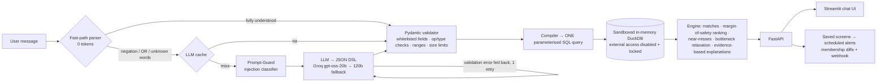

# Scout: Natural-Language Stock Screener (NSE · Nifty 500)

Describe the stocks you want in plain English. Examples: *"profitable companies with low debt and increasing revenue"*, *"undervalued banks with ROE above 15"*, *"now only large caps, and drop the debt filter"*. The system turns the request into a **validated, inspectable screen**, runs it on NSE data, and explains **with real numbers** why each stock matched. It also shows which stocks *almost* matched and which single condition is blocking results. Screens can be saved and turned into alerts that fire when stocks enter or leave them.

```
./run.sh            # API → http://127.0.0.1:8000/docs   UI → http://127.0.0.1:8501
```

---

## 1. The core design decision: the LLM never touches the data

Most text-to-SQL approaches let the model write SQL. That is hard to verify, it is a prompt-injection-to-SQL-injection path, and it spends tokens on every request. Here the LLM has exactly one narrow job: translating language into a **typed screen DSL**. Everything after that is deterministic.



| Concern | How it is handled |
|---|---|
| **Correctness** | The LLM only produces JSON matching a schema. Unknown fields, wrong operator/type pairs, out-of-range values and over-large screens are rejected *before* any query exists. The validation error is fed back to the model for one self-repair attempt. |
| **Security** | Identifiers come only from a registry whitelist, and every value is a bound parameter. The query runs on an in-memory DuckDB with `enable_external_access=false` and `lock_configuration=true`, so even a compiler bug couldn't read files. Raw input goes through a Prompt-Guard classifier. Other layers: API-key auth, per-key rate limits, request size caps, query timeout, and SSRF-safe webhooks (https only, public IPs only). |
| **Explainability** | Explanations are rendered from the AST plus the actual values (`Debt/Equity 0.12x < 0.50x · from "low debt"`). They cannot hallucinate, and they cost zero tokens. |
| **Cost** | A deterministic fast path answers common phrasings with **0 tokens**. LLM answers are cached by (prompt version, models, normalised text, current screen). Follow-ups send a *patch*, not the whole conversation. |

## 2. What's different here

1. **Vague words get explicit, editable definitions.** "Low debt", "undervalued" and "quality" map to definitions in a single glossary ([screener/registry.py](screener/registry.py)) that both the fast path and the LLM prompt use. So *"companies that make money, don't borrow much and whose sales keep going up"* (LLM) and *"profitable, low debt, increasing revenue"* (fast path) return **the same 193 stocks**. Every assumed threshold shows in the UI as an amber chip with its rationale, and you can edit it or remove it without calling the LLM.
2. **Peer-relative thresholds.** "Undervalued" means *P/E below the stock's own sector median*, because a P/E of 25 is cheap for FMCG and expensive for PSU banks. The DSL supports `sector_median`, `sector_pctile`, `universe_pctile` and field-to-field references, compiled to window functions.
3. **Domain-aware not-applicable handling.** Debt/Equity and interest coverage are set to *not meaningful* for Financial Services (deposits are a bank's raw material), and the explanation says so instead of silently failing banks.
4. **Every criterion becomes a boolean column.** Instead of `WHERE a AND b AND c`, the compiler projects each criterion as its own column. One scan therefore yields matches, per-criterion pass rates (a funnel: "271 of 497 pass low debt"), **near-misses** (failed exactly one numeric condition, ranked by gap), and evidence for each stock.
5. **Margin-of-safety ranking.** Matches are ranked by how *comfortably* they clear each condition, normalised by the field's cross-sectional IQR, so P/E and ROE margins are comparable. Borderline qualifiers are flagged: "qualifies, but only just on D/E".
6. **Bottleneck analysis for empty results.** When a screen returns fewer than 5 stocks, the engine finds the single condition whose relaxation unlocks the most stocks and computes the exact threshold needed. The UI shows this as a one-click button (`Relax to Delivery % ≥ 45.1% → 1 stock`).
7. **Conversation as AST patches.** "Only banks", "drop the debt filter" and "sort by ROE" become patch ops (`add/remove/replace/set_sort…`) on the current screen, with a visible change log. Purely additive follow-ups are patched with no LLM call at all.
8. **Zero-token diagnostics.** "Why isn't TCS here?" returns per-criterion pass/fail evidence for that stock, or its rank if it does match.
9. **Honest about gaps.** Concepts the data can't express (ESG, management quality, news sentiment) are reported back as *not applied*, never dropped silently.
10. **Point-in-time backtest of any screen.** The snapshot builder can be run *as of any date*, using only prices up to that day and financial results whose **SEBI LODR filing deadline** (45 days after quarter end, 60 after FY end) had passed. The backtest therefore has no look-ahead bias from fundamentals.
11. **Alerts are membership diffs.** A saved screen is just a stored DSL. The scheduler re-evaluates it whenever the data refreshes and records *entered* events (with the same evidence) and *exited* events (naming the criterion that now fails). Delivery is to an inbox plus an optional Slack/Discord/Teams-compatible webhook.

## 3. Data: NSE public archives + yfinance fundamentals

| Dataset | Source | Used for |
|---|---|---|
| Index constituents (Nifty 50/100/200/500) | `nsearchives.nseindia.com/content/indices/ind_nifty*list.csv` | universe, NSE sector classification |
| Full bhavcopy **with delivery %** (`sec_bhavdata_full_DDMMYYYY.csv`) | NSE archives, ~600 days | OHLCV, turnover, delivery-based signals, all technicals |
| Index closes (`ind_close_all_DDMMYYYY.csv`) | NSE archives | Nifty 50 beta, relative strength vs Nifty 500, backtest benchmark |
| Quarterly and annual P&L, balance sheet, cash flow; shares; promoter holding | yfinance (`.NS`) | fundamentals |

The result is 63 fields per stock across valuation, profitability, growth, balance sheet, technicals and India-specific signals: **delivery % and its trend** (accumulation), **promoter holding**, and **SEBI/AMFI market-cap class** (rank 1–100 large, 101–250 mid, 251+ small).

### Data problems found and fixed (each would have silently corrupted results)
- **Unadjusted splits and bonuses.** NSE's `PREV_CLOSE` in this file is *not* adjusted, and a 1:10 split looks like a −90% crash (Bajaj Finance, June 2025). Fix: under NSE's price-band regime a one-day move beyond −35%/+80% can't be a market move, so it's treated as a corporate action and the factor snaps to the nearest standard split/bonus ratio. This found 33 real events, with no paid corporate-actions feed.
- **Weekend special sessions.** The Union Budget session (Sun 1 Feb 2026) and Diwali Muhurat trading (Sun 8 Nov 2026) were missed by a weekday-only downloader. That broke return calculations and produced false "corporate actions" across 150+ stocks on one day. Fix: fetch every calendar day (non-sessions simply 404), plus a guard that treats an event hitting ≥10% of stocks on one day as a data gap, not a corporate action.
- **Mislabelled dates.** NSE sometimes serves a neighbouring session's file for a requested date. Rows are stamped with the date printed *inside* the file and deduplicated.
- **Currency mismatch.** Infosys and Wipro report in USD on Yahoo, which produced a P/E of 1,386. Fix: read `financialCurrency` and convert at the USD/INR rate on each statement's period-end date. Infosys P/E is now 14.8.

## 4. Evaluation

`python -m eval.run_eval` scores 30 hand-labelled queries (explicit, vague, sector, negation, OR, sort, technical, colloquial, unmappable, adversarial, off-topic) at the condition level. `> / >=` count as the same direction, and vague terms accept any threshold.

| Metric | Result |
|---|---|
| Condition precision / recall / F1 | **98.3% / 96.6% / 97.4%** |
| Answered by zero-token fast path | 13 / 30 (100% precision on those) |
| Injection / off-topic correctly refused | 2 / 2 |
| Unmappable concepts surfaced to the user | 2 / 2 |
| Tokens for the full 30-query run | ~39k (reruns: 0, served from cache) |

Per-category results are in [eval/results.txt](eval/results.txt). `python -m eval.run_eval --no-llm` measures the fast path alone.
`pytest -q` runs 20 offline tests covering validator rejection, parameterisation, sandbox file-access denial, fast-path coverage and hand-off, patching, near-misses, sector-relative references, relaxation, split adjustment and point-in-time lag.

## 5. LLM usage on a free tier

Groq's free tier allows **8k tokens/minute per model**, and a call costs about 2.1k tokens. The design treats tokens as the scarce resource:

- Fast path first: about 40% of realistic queries use no LLM.
- Compact prompt: only non-obvious fields carry descriptions (≈1.75k tokens).
- Cache keyed on normalised text plus the current screen. Bump `PROMPT_VERSION` to invalidate.
- `reasoning_effort=low`, JSON mode, `max_tokens` cap, at most one repair retry.
- Rate-limit aware: on HTTP 429, try the next model first. If all are throttled, wait for the server's `x-ratelimit-reset-tokens` (capped at 20 s) once, then **degrade gracefully** to the partial deterministic parse, clearly labelled as such.
- Prompt-Guard (`llama-prompt-guard-2-22m`) uses a separate quota, bills 0 tokens, and is skipped on cache hits.

The provider is configurable (`LLM_BASE_URL`, `LLM_MODELS`): any OpenAI-compatible endpoint works, such as OpenRouter, Gemini's OpenAI endpoint or a local Ollama.

## 6. API (OpenAPI docs at `/docs`)

All `/v1/*` routes need the `X-API-Key` header.

| Method | Path | Purpose |
|---|---|---|
| POST | `/v1/chat` | message (+ `session_id`) → interpretation, results, explanations, near-misses, suggestions |
| POST | `/v1/screen` | run an explicit DSL deterministically (chip edits) |
| POST | `/v1/screen/patch` | apply patch ops (e.g. a relaxation suggestion) and re-run |
| POST | `/v1/explain` | per-criterion evidence for one symbol |
| GET | `/v1/stocks/{symbol}` | all 63 fields for a stock |
| POST/GET/DELETE | `/v1/screens` | saved screens |
| POST/GET/DELETE | `/v1/alerts`, GET `/v1/alerts/events`, POST `/v1/alerts/run` | alerts, inbox, manual trigger |
| POST | `/v1/backtest` | point-in-time backtest of a screen |
| GET | `/v1/meta`, `/v1/stats`, `/health` | registry/glossary, routing telemetry, status |

## 7. Running it

```bash
python3 -m venv .venv && .venv/bin/pip install -r requirements.txt
cp .env.example .env            # add a free Groq key (console.groq.com); without one, the fast path still works
.venv/bin/python -m etl.run     # ~5 min first time: NSE archives + fundamentals → data/market.duckdb
./run.sh
```

**Alert demo:** `python -m etl.run --snapshot-only --as-of 2026-11-10`, then save a screen with an alert in the UI, then `python -m etl.run --snapshot-only` and click **Check alerts now**. The API hot-reloads the snapshot when the file changes. On real data this produced 25 entered/exited events for a momentum screen between 9 and 25 Nov.

## 8. Repository map

```
etl/        nse.py (archives, split detection) · fundamentals.py (yfinance + FX) · run.py (CLI)
screener/   registry.py (fields + glossary: single source of truth) · snapshot.py (point-in-time features)
            dsl.py (AST, validation, patches) · compiler.py (AST → parameterised SQL) · engine.py (execution,
            explanations, near-misses, relaxation, backtest) · fastpath.py · llm.py · parser.py · alerts.py · store.py
api/        main.py (FastAPI)          ui/  app.py (Streamlit, pure API client)
eval/       queries.jsonl + run_eval.py              tests/  test_core.py
```

## 9. Known limitations and next steps

- **Fundamentals depth:** yfinance gives about 4 annual and about 5 quarterly periods, so growth streaks are capped at 3 years. Production would use exchange XBRL filings (NSE/BSE financial results) for 10+ years of history.
- **Point-in-time gaps:** share count, promoter holding and dividend yield are current values. The backtest universe is today's Nifty 500, which introduces survivorship bias. Both are disclosed in every backtest response.
- **Promoter holding** comes from Yahoo's insider-holding figure. NSE shareholding-pattern filings would be authoritative.
- **Scale:** a 500-row snapshot is held in memory. At 5,000+ symbols the same compiler targets a persistent DuckDB or Postgres without changing the DSL.
- **Next:** per-user default definitions ("for me, low debt means D/E < 0.3"), learned from chip edits. Also more alert types (threshold crossings and rank changes), and alert delivery by email or Telegram.
