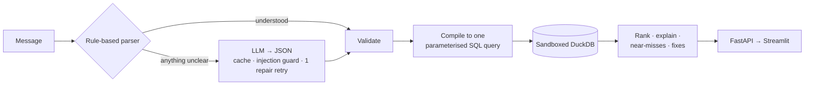

# Scout

A natural-language stock screener for the Nifty 500.

Ask for stocks the way you'd describe them, for example *"profitable companies with low debt and increasing revenue"*. Scout turns that into a structured screen you can inspect and edit, then runs it on NSE data. It shows which stocks match and why, using real numbers. Follow-ups refine the same screen ("only large caps", "drop the debt filter", "why isn't TCS here?"), and any screen can be saved as an alert.

```bash
./run.sh        # API on :8000 (docs at /docs), UI on :8501
```

## How it works

The LLM never writes SQL. Its only job is to translate a sentence into a small JSON screen format (the DSL). Every step after that is ordinary, deterministic code.



1. **Understand.** A rule-based parser handles common phrasings at no token cost. It only answers when it accounts for every word; negation, "or" and any unfamiliar word go to the LLM (Groq `gpt-oss-20b`, with `120b` as fallback).
2. **Validate.** Pydantic rejects unknown fields, operators that don't fit the field type, out-of-range values and oversized screens. When the LLM gets it wrong, the error goes back to it once so it can correct itself.
3. **Compile.** Column names come from a whitelist and every value is a bound parameter. Each condition becomes its own true/false column instead of a `WHERE` clause, so one scan gives the matches, the pass rate of each condition, the near-misses and the evidence for each stock.
4. **Execute.** The query runs on an in-memory DuckDB with file and network access switched off and the settings locked.
5. **Explain.** Reasons are generated from the screen and the stock's actual values, e.g. `Debt / Equity 0.12x < 0.50x · from "low debt"`, so they can't be invented by a model.

## Design choices

- **One glossary for vague words.** "Low debt", "undervalued" and "quality" each have a single definition in [registry.py](screener/registry.py), used by both the parser and the LLM prompt. Each definition is either a published convention (SEBI cap classes, Wilder's RSI 30/70), a literal reading ("profitable" means profit > 0), or relative to peers ("cheap" means P/E below the sector median). Assumed thresholds appear as amber chips that you can edit or remove. A loose phrasing like *"make money, don't borrow much, sales keep going up"* returns the same 193 stocks as the standard query.
- **Valuation compared with peers.** A P/E of 25 is cheap for FMCG and expensive for PSU banks, so the DSL supports sector and universe medians and percentiles, compiled to window functions.
- **Ranked by margin of safety.** Matches are ordered by how comfortably they clear each condition. Each margin is measured in units of that field's interquartile range, which makes a P/E margin comparable with an ROE margin. Stocks that only just qualify are flagged.
- **Help when a screen is too strict.** Near-misses show stocks that failed exactly one condition. When fewer than 5 stocks match, Scout finds the condition holding results back and offers a one-click fix ("Relax to ROE ≥ 15.2% → 5 stocks").
- **Conversation as edits.** Follow-ups become patch operations on the current screen (`add`, `remove`, `replace`, `set_sort`…). Simple additions and "why isn't X here?" questions use no LLM at all.
- **Honest about gaps.** Anything the data can't express (ESG, news, management quality) is shown as *not applied* rather than silently ignored. Debt ratios are marked *not meaningful* for banks rather than counted as a fail.
- **Alerts track who enters and leaves a screen.** A saved screen is just its stored definition. After each data refresh, Scout records which stocks entered (with the same evidence as a search result) and which left (with the condition they now fail). Alerts appear in an inbox and can also be sent to a Slack, Discord or Teams webhook.
- **Backtests without look-ahead.** Any screen can be re-run as of a past date, using only prices up to that day and results whose SEBI LODR filing deadline had passed (45 days after a quarter, 60 after the financial year).

## Data

| Source | Gives |
|---|---|
| NSE index lists (Nifty 50/100/200/500) | universe, sector, index membership |
| NSE full bhavcopy, ~600 days | daily prices, turnover, **delivery %** |
| NSE index closes | Nifty 50 / Nifty 500 benchmarks |
| yfinance (`.NS`) | financial statements, shares outstanding, promoter holding |

From these, Scout builds a table with one row per stock and 63 fields. The fields cover valuation, profitability, growth, balance sheet and technicals, plus India-specific ones: delivery trend, promoter holding and the SEBI cap class.

Four data problems would each have silently corrupted results:

- **Splits looked like crashes.** NSE's file isn't split-adjusted, so a 1:10 split looks like a 90% fall. Price bands make a one-day move beyond −35%/+80% practically impossible, so such a jump is treated as a corporate action and snapped to the nearest standard ratio. This found 33 events without a paid corporate-actions feed.
- **Weekend sessions were missing.** NSE traded on Sunday 1 Feb 2026 (Budget day) and Sunday 8 Nov 2026 (Muhurat trading). The downloader now fetches every calendar day.
- **Some files had the wrong date.** NSE sometimes serves a neighbouring day's file, so rows use the date printed inside the file.
- **Currencies were mixed.** Infosys and Wipro report in USD on Yahoo, which gave Infosys a P/E of 1,386. Statements are now converted at the USD/INR rate of their period-end date.

## Results

Scout was evaluated on 30 hand-labelled queries ([eval/](eval/)): explicit, vague, sector, negation, OR, sort, technical, colloquial, unmappable and adversarial.

| | |
|---|---|
| Condition precision / recall / F1 | **98.3% / 100% / 99.2%** |
| Answered with zero tokens | 14 / 30 (all correct) |
| Injection and off-topic refused | 2 / 2 |
| Unmappable terms reported | 2 / 2 |
| Tokens for the full run | ~40k (reruns are free: cached) |

`pytest -q` runs 25 offline tests: validation, SQL parameterisation, the sandbox, parser hand-off, patches, ranking, relaxation, split adjustment and the filing-lag rule.

**Free-tier budget.** Groq allows 8k tokens per minute per model and a call costs about 2k. To stay inside that:
- the parser answers first
- the prompt is compact
- the cache key includes the prompt text, so editing the glossary invalidates old answers automatically
- when one model is rate-limited, Scout switches to the other
- if all else fails, it returns the partial rule-based result and labels it as such

## Run it

```bash
python3 -m venv .venv && .venv/bin/pip install -r requirements.txt
cp .env.example .env            # add a free Groq key; without one, the rule-based parser still works
.venv/bin/python -m etl.run     # first run ~5 min → data/market.duckdb
./run.sh
```

To see alerts fire, build an older snapshot (`python -m etl.run --snapshot-only --as-of 2026-11-10`), save a screen with an alert, rebuild the current snapshot (`python -m etl.run --snapshot-only`), then click **Check alerts now**.

**Hosted demo:** [deploy/streamlit/](deploy/streamlit/) runs on Streamlit Community Cloud. It starts the API inside the Streamlit process and serves a bundled snapshot dated 25 Nov 2026.

The API requires an `X-API-Key` header and has OpenAPI docs at `/docs`. Its main routes:
- `/v1/chat`
- `/v1/screen` and `/v1/screen/patch` (edits without the LLM)
- `/v1/explain`
- `/v1/screens`
- `/v1/alerts`
- `/v1/backtest`

```
etl/       NSE archives, split detection, fundamentals + FX
screener/  registry (fields + glossary) · snapshot · dsl · compiler · engine · fastpath · llm · parser · alerts · store
api/       FastAPI          ui/  Streamlit (talks only to the API)
eval/      labelled queries + scorer          tests/  unit tests
```

## Limitations

- yfinance gives about 4 years of annual data, so growth streaks top out at 3 years. NSE/BSE XBRL filings would give 10+ years.
- Share count, promoter holding and dividend yield are current values, and the backtest uses today's Nifty 500 (survivorship bias). Both are stated in every backtest result.
- Promoter holding is Yahoo's insider figure. NSE shareholding filings would be authoritative.
- The 500-row snapshot lives in memory. A larger universe would point the same compiler at a persistent DuckDB or Postgres.
